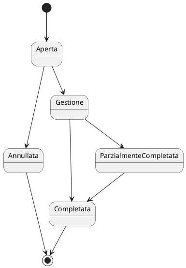
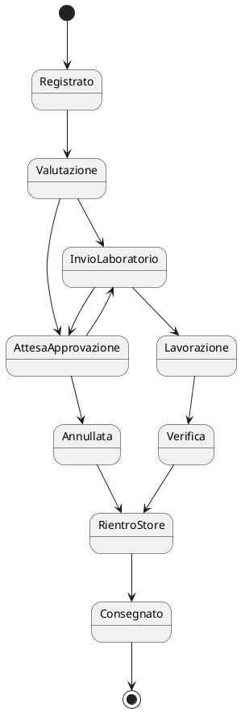
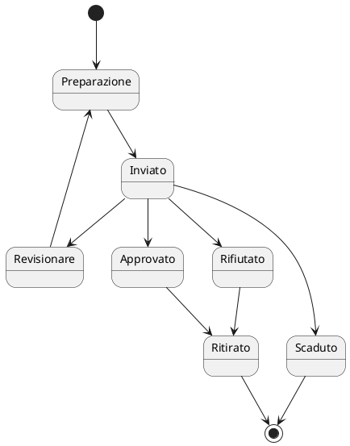
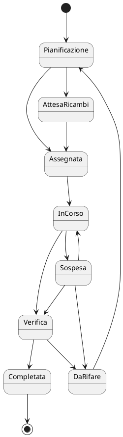

# Flussi operativi — NODUS

## Flusso standard

> Un __Organizzazione__ iscritta alla piattaforma ha una __Sede__ con tipologia _Store__, arriva un cliente con una riparazione da effettuare

1. Lo _Store_ crea una __Pratica__ .
2. Registra il __Cliente__ e i suoi dati di contatto.
3. Registra uno o più __Oggetti__, con descrizione, condizioni iniziali e immagini(**Allegato**).

> In __Nodus__ esistono delle __Organizzazioni__ che hanno una __Sede__ con tipologia __Laboratorio__

1. Per un oggetto invia una richiesta di __Preventivo__ (aperta a tutti i _Laboratori_ da qui è gia stata servita), se necessarie ulteriori informazioni può richiedere la __Spedizione__ dell'oggetto.
2. Ogni _laboratorio_ prepara una proposta indipendente.
3. Lo _store_ confronta, accetta o rifiuta le proposte di __Preventivo__.
4. l'__oggetto__ viene spedito al _laboratorio_ selezionato e viene effettuata una variazione del registro TULPS
5. il laboratorio riceve l'oggetto conferma il preventivo o comunica eventuali modifiche, e registra le lavorazioni da eseguire e l'oggetto ricevuto nel suo registro TULPS.
6. Le lavorazioni approvate vengono pianificate e assegnate. vengono definiti attrezzature, ricambi e risorse necessarie. se le risorse non dispobibili comunica l'attesa dei ricambi.
7. Il laboratorio aggiorna lo stato delle attività e segnala eventuali imprevisti.
8. Le lavorazioni vengono completate e sottoposte ai controlli previsti.
9. il laboratorio registra la chiusura del preventivo e procede alla spezione di ritorno e la variazione del suo registro TULPS
10. L'oggetto rientra allo store e viene consegnato al cliente. la pratica viene chiusa e registrata la variazione nel registro TULPS dello Store

## Stati da definire

### Pratica

Esempi: aperta, in gestione, parzialmente completata, completata, annullata.

### Oggetto

Esempi: registrato, in valutazione, in attesa di approvazione, in lavorazione, in verifica, rientrato allo store, consegnato.

### Preventivo

Esempi: in preparazione, inviato, da revisionare, approvato, rifiutato, scaduto, ritirato.

### Lavorazione

Esempi: da pianificare, assegnata, in attesa, in corso, sospesa, completata, da verificare, da rifare, annullata.

Gli stati definitivi, le transizioni ammesse e gli utenti autorizzati a eseguirle devono essere specificati prima dello sviluppo.

## Casi particolari da coprire

- Più oggetti nella stessa pratica con avanzamenti indipendenti.
- Più preventivi alternativi per lo stesso oggetto.
- Più lavorazioni complementari sullo stesso oggetto.
- Lavorazioni sequenziali o parallele.
- Trasferimento dell'oggetto tra laboratori.
- Preventivo revisionato dopo una prima proposta.
- Lavorazione sospesa per mancanza di ricambi.
- Intervento aggiuntivo richiesto dopo l'ispezione.
- Rilavorazione dopo il controllo qualità.
- Annullamento con attività già avviate.
