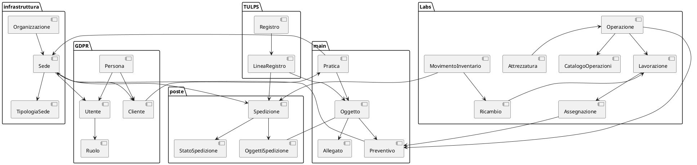

# Modello dati — NODUS

Prima bozza concettuale. Non costituisce ancora uno schema database definitivo.

## Entità principali

| Entità | Descrizione |
|---|---|
| Organizzazione | Store, laboratorio o gestore della piattaforma |
| Sede | Punto operativo appartenente a un'organizzazione |
| Utente | Persona che accede al sistema |
| Ruolo/Permesso | Definisce le azioni consentite |
| Pratica | Richiesta di riparazione aperta da uno store |
| Oggetto | Singolo bene incluso in una pratica |
| Preventivo | Proposta tecnica ed economica riferita a un oggetto |
| Laboratorio | Profilo operativo di un'organizzazione di tipo laboratorio |
| Operazione | Tipo di lavorazione presente nel catalogo |
| Lavorazione | Attività concreta da eseguire su un oggetto |
| Assegnazione | Incarico affidato a un laboratorio o operatore |
| Attrezzatura | Strumento o macchinario del laboratorio |
| Ricambio/Materiale | Articolo gestito a magazzino |
| Movimento inventario | Carico, scarico o rettifica di una giacenza |
| Allegato | Foto, documento o file associato a un record |
| Evento/Storico | Traccia delle modifiche e delle azioni |

## Relazioni da preservare

- Una pratica contiene uno o più oggetti.
- Un oggetto appartiene a una sola pratica.
- Un oggetto può avere più preventivi.
- Un preventivo è riferito a un solo oggetto e proviene da un laboratorio.
- Un oggetto può richiedere più lavorazioni.
- Una lavorazione può essere assegnata a un laboratorio e, se necessario, a un operatore.
- Un laboratorio dichiara le operazioni che è in grado di svolgere e le risorse disponibili.

## Questioni da decidere

- Un preventivo può includere più lavorazioni? (proposta: sì)
- Una lavorazione può essere suddivisa in sotto-attività?
- Un oggetto può essere trasferito tra laboratori durante la stessa pratica?
- Come si gestiscono materiali e ricambi riservati a una specifica lavorazione?
- Quali dati del cliente sono visibili al laboratorio?
- Quali informazioni devono essere conservate nello storico e per quanto tempo?

